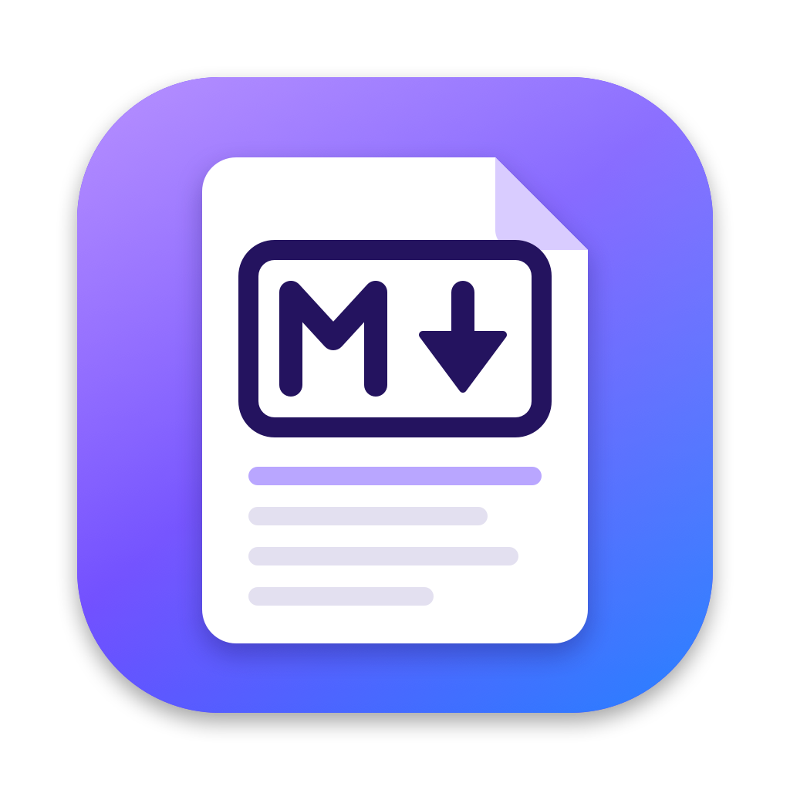

<p align="center"></p>

<h1 align="center">Markdown Preview</h1>

<p align="center">A tiny, native Markdown viewer and editor for macOS, with a Quick Look extension.<br>
GitHub-style rendering, math, live preview. No Electron, no web server, about 2.5 MB.</p>

---

## Features

**Quick Look.** Select a `.md` file in Finder and press Space to see it rendered.

**App.** Double-click a Markdown file to open it as a rendered page.

- **Edit side by side.** Press ⌘E (or the pencil button) to open an editor next to a live preview. The window grows to fit both panes if it needs to.
- **Selections stay in sync.** Select a word in either pane and the same word is selected in the other. Clicking in the preview moves the editor's cursor there.
- **A normal Mac document app.** Autosave, Versions, Revert, Undo, Find, tabs, Open Recent, Print / Save as PDF, and zoom (⌘+ / ⌘− / ⌘0).
- **Links.** Web links open in your browser, links to other `.md` files open in the app, and `#anchors` scroll within the page.
- **Reloads automatically** when the file changes on disk and you have no unsaved edits.

**Rendering** (shared by both):

- GitHub Flavored Markdown: tables, task lists, strikethrough, autolinks, reference-style links, raw HTML, and `> [!NOTE]` / `[!TIP]` / `[!WARNING]` alerts with GitHub's icons.
- GitHub's stylesheet (fonts, spacing and colours), in both light and dark mode.
- Syntax highlighting for about 50 languages, using GitHub's colours.
- Math with KaTeX: `$…$`, `$$…$$`, ` ```math ` blocks and `` $`…`$ ``. ` ```latex ` / ` ```tex ` blocks are also rendered as math if they parse.
- Local images next to the file are displayed.

## Install

Requires macOS 12 or later and the Xcode Command Line Tools (`xcode-select --install`). Xcode itself isn't needed.

```bash
git clone https://github.com/randhindi/mini-markdown.git
cd mini-markdown
./build.sh install
```

This builds a universal (Apple Silicon and Intel) app, installs it to `~/Applications`, and registers the Quick Look extension. When you first launch the app, it offers to become the default app for Markdown files. You can also set this from **Markdown Preview ▸ Make Default Markdown App**.

If Finder still shows an old preview, run `qlmanage -r`.

To uninstall, run `./build.sh uninstall`.

> [!NOTE]
> The app is ad-hoc signed, which is enough on the Mac that built it. Copying the built app to another Mac means getting past Gatekeeper (right-click ▸ Open). Building from source on each Mac avoids this.

## Development

```bash
./build.sh               # build build/MarkdownPreview.app
./build.sh test          # render Tests/*.md and diff against Tests/*.expected.html
./build.sh test --update # accept rendering changes
./build.sh render f.md   # print the HTML for a file
./build.sh icon          # regenerate the icon from Tools/make-icon.swift
```

### Layout

| Path | What it is |
|---|---|
| `Sources/Shared/Markdown.swift` | Markdown → HTML renderer (block and inline parser, no dependencies) |
| `Sources/Shared/Highlighter.swift` | Small regex-based code highlighter |
| `Sources/Shared/Math.swift` | TeX → MathML, by running the bundled KaTeX in JavaScriptCore |
| `Sources/Shared/Page.swift` | HTML page wrapper and GitHub-derived CSS |
| `Sources/Extension/` | Quick Look preview extension (data-based HTML preview) |
| `Sources/App/` | Viewer/editor app: `NSDocument`, `NSTextView` editor, `WKWebView` preview, selection sync |
| `Resources/` | Info.plists, entitlements, icon, KaTeX |
| `Tools/` | Icon generator and a command-line renderer used by the tests |

### How it works

Markdown is converted to HTML in Swift. Math is turned into MathML ahead of time by KaTeX running in JavaScriptCore, and WebKit draws MathML natively. So the Quick Look preview runs no scripts and needs no web fonts. The app uses the same renderer and also tags each block with its source line numbers, which is what powers the selection syncing between the two panes.

## Credits

- Math rendering by [KaTeX](https://katex.org) (MIT), bundled in `Resources/katex/`.
- Styling follows [github-markdown-css](https://github.com/sindresorhus/github-markdown-css). Alert icons are from [Octicons](https://github.com/primer/octicons) (MIT).

## License

[MIT](LICENSE)
